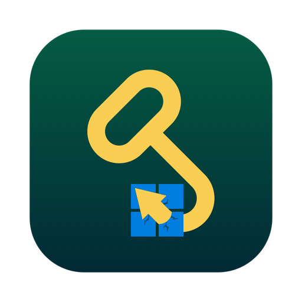

## Alpha V1.3.0 — HookLink X3 + updated original NXnative

- Integrates HookLink X3 (4.0), engine ee3ce6a02bc7, with official NXnative 5dfc86ae80c5. Official NXnative is the base; X3 wins overlapping changes. All 64 upstream and 20 Windows replay conflict hunks have explicit resolutions.
- Keeps HookLink's measured frame duration at state +0x38; the official optional tick-unit field is moved to +0x48. The conflicting official Ocarina 40 fps stub is not offered. The X3 frame-workgroup implementation is preserved.
- Preserves independent Windows build/SDK/translator compatibility, the Ocarina 16 GiB alias, and existing caches. New shader-chain d0977c64f9e8 is generated from the integrated sources; Windows preflight verifies the installed translator and may rebuild shaders.
- Includes the X3 engine/desktop changes, packaged background support, mod resource-size-table packaging, and native Custom controller layout. The Windows UIKit launcher does not yet include X3’s full SwiftUI photo picker or mod-management UI. End-to-end game IPA and device runtime require user testing.
- Exact source inventories and conflict decisions are in ENGINE_PIN_FILES.json. See the original X3 changelog in docs/HOOKLINK_X3_UPSTREAM_CHANGELOG.md.

## Alpha V1.2.8 — Windows build compatibility and X3 integration preparation

**Integration preparation release — HookLink X3 (4.0) and the newer official NXnative engine are NOT included yet.** The bundled engine remains HookLink X2.0.1 / official NXnative `3e1ada5b96ac`, with shader chain `f062f816dfb7`.

This release prepares the Windows host source-list parser and address-region wrapper for upcoming upstream changes, adds five regression tests, and includes the read-only integration audit. The full X3/official-engine merge remains in progress. See the [integration checklist](docs/V128_INTEGRATION_STATUS.md) and [changelog](CHANGELOG.md).

## Alpha V1.2.7 — robust iPhoneOS SDK discovery on Windows

Fixes the `plistlib.InvalidFileException` thrown by V1.2.6 when Windows discovers a truncated or otherwise invalid `SDKSettings.plist` in a nearby SDK directory. SDK discovery now skips bad metadata and can find a valid SDK elsewhere; it still requires genuine iPhoneOS SDK 26+ metadata, headers and frameworks. Broken Apple SDK metadata is **not** repaired by this update. If prerequisites now report no valid SDK, select or reimport a valid iPhoneOS SDK via **Toolchain setup**.

This update leaves the original NXnative engine revision `3e1ada5b96ac`, shader chain `f062f816dfb7`, and game/shader work caches unchanged. Extract the new full Windows package separately, open the V1.2.7 GUI, keep the existing build directory, and retry **Check prerequisites** followed by **Build IPA**. V1.2.7 has not yet had an end-to-end native IPA/device test.

## Alpha V1.2.6 — repair Windows SDK patch registration after the upstream merge

The V1.2.5 Windows IPA build could stop after NUP extraction with `AttributeError: module 'sdk_patches' has no attribute 'CUTS'`. The original NXnative engine now registers generic SDK patches using `MATCH_CUTS['sdk']`, not the old exact-build `CUTS` dictionary. V1.2.6 fixes the Windows driver to honor upstream's function-matched rules and only use its legacy raw SDK scanner when **neither** exact-build cuts nor upstream SDK-wide match rules exist. It adds regression tests and does not alter the original NXnative engine pin or the shader chain.

**For an existing V1.2.5 work directory:** download the new complete Windows ZIP, extract it separately, open its `HookLinkWindows.exe`, select the same build directory, and retry **Build IPA**. Do not erase the extracted game or shader caches. The three damaged `.zs` input-file warnings are separate; they are not fixed by this update.

## Alpha V1.2.5 — integrate 50 original NXnative commits without regressing HookLinkWindows

This release merges **all 50 original [NXnative](https://github.com/seedds/nxnative) commits** from `3ec5b785` through [`3e1ada5b`](https://github.com/seedds/nxnative/commit/3e1ada5b96acb61293ac790bd6dd093a947abed6), affecting 168 original paths. All compatible upstream source is integrated through a real Git three-way merge. The 11 overlapping paths receive individually documented, source-hunk-level reconciliation rather than preserving stale whole Windows files.

Notable upstream additions include efficient in-process shader archive reading and NXSD support, more robust Metal texture size validation and archive writes, revised memory and input handling, and Ocarina of Time's native taller-screen hooks. The integration preserves HookLink's tested v131072 iPhone camera/wide-view, 16 GiB alias reservation, movie timing, iOS launcher, audio, shader path normalization and Windows build tools. See [V1.2.5 upstream integration](docs/NXNATIVE_RECENT_UPSTREAM_V125.md) and [the changelog](CHANGELOG.md). **This upstream update requires a new Windows IPA and iPhone runtime test** before declaring V1.2.5 itself fully verified; keep existing working IPA/shader caches available.

## Alpha V1.2.4 — repair native Metal compilation and merge the latest original NXnative

V1.2.3 compiled all 42,847 Ocarina iOS game shaders but stopped compiling the iOS host with five native errors. V1.2.4 restores screenshot synchronization (`shot_ready`), both present-callback producer event arguments, snapshot queue-commit timing (`elapsed`), and removes the obsolete NDVE `dp` reference while keeping HookLink's frame-generation and NDVE lite behavior.

The engine is also updated from official NXnative `d2fd78b402f9` to **`3ec5b785f37f`**, integrating all four additional upstream commits (audio route-change stall recovery, shader gather offsets, NUP metadata validation and OpenGL changes). A complete Git three-way source audit found zero new source conflicts. The shader translation chain has changed: **the GUI will verify/synchronize the local Windows compiler lock before building and may need to rebuild the game shaders**, preserving old archives. See [recent upstream integration](docs/NXNATIVE_RECENT_UPSTREAM_V124.md). This source fix still requires a full IPA and iPhone gameplay/audio test to verify the native build.

<h1 align="center">HookLinkWindows</h1>

<strong>Build an iPhone app from your own supported Ocarina of Time `.nup` — using Windows.</strong>

<a href="#download">Download</a> ·
<a href="#project-status">Status</a> ·
<a href="#requirements">Requirements</a> ·
<a href="#quick-start-windows">Quick start</a> ·
<a href="#install-on-iphone">Install on iPhone</a> ·
<a href="#troubleshooting">Troubleshooting</a> ·
<a href="#engine-and-upstream">Engine</a> ·
<a href="#credits">Credits</a>

> [!IMPORTANT]
> **Alpha software — not a one-click game installer.** HookLinkWindows is an experimental, Windows-hosted build tool for producing an iOS app **locally from game files you already own**. It does not distribute the game, an IPA containing game assets, signing credentials, Apple SDKs, or proprietary compiler binaries. You must provide the required tools and game input yourself. Do not upload or redistribute game dumps, generated IPAs, RomFS images, shader caches, private keys, or saves.

HookLinkWindows combines the [HookLink](https://github.com/dsi-hub/HookLink) , [NXnativeWindows](https://github.com/zenvyzenshiro/NXNativeWindows) and [NXnative](https://github.com/seedds/nxnative) projects to a **Windows-first, GUI-based workflow**. It translates game code and graphics for iOS/Metal rather than using a conventional Switch emulator. It is a **builder for iPhone**, not a Windows port of the game itself.

## Download

**Latest release: [Alpha V1.3.0](https://github.com/BluePhoenix120/HookLinkWindows/releases/latest)**

| Download | Intended use |
|---|---|
| **[Complete Windows package (ZIP)](https://github.com/BluePhoenix120/HookLinkWindows/releases/download/v1.3.0-alpha.1/HookLinkWindows-Windows-x64.zip)** | **Recommended.** Contains the Windows GUI executable together with the source tree, integrated engine and build scripts needed for IPA compilation. |
| [Standalone GUI EXE](https://github.com/BluePhoenix120/HookLinkWindows/releases/download/v1.3.0-alpha.1/HookLinkWindows.exe) | GUI launcher only. **Not sufficient to build an IPA by itself.** Use the complete ZIP instead. |
| [Source code](https://github.com/BluePhoenix120/HookLinkWindows) | For contributors and users who want to inspect the project or work from a Git checkout. |

1. Download the **complete ZIP** and extract it to a writable Windows folder (for example, somewhere on `D:\`).
2. Keep `HookLinkWindows.exe` in the extracted **project root** beside `win/`, `engine/`, `config/` and `docs/`. Do **not** move the EXE out on its own.
3. Open `HookLinkWindows.exe`. The bundled GUI can open without a separate Python installation, but **building the game still requires Python and the other prerequisites** listed below.

Windows may display an unsigned-app security warning. Check the publisher/source, release location and files before deciding whether to run an unsigned executable. This is not a Microsoft Store installer.

## Project status

**Alpha V1.3.0 — experimental Windows port (November 2026).**

| Area | Status |
|---|---|
| Windows GUI, package creation and automated regression tests | Windows GUI CI gates the release; end-to-end V1.2.8 IPA and device testing remain outstanding |
| Source integration | Complete original NXnative `3e1ada5b` integrated through 50 upstream commits, with HookLink/Windows source differences reviewed at the hunk level; see [Engine and upstream](#engine-and-upstream) |
| Fresh Windows install → full NUP build → signed IPA → iPhone game rendering | **Verified by developer for V1.2.0** on iPhone 18 Pro Max/iOS 27.2: gameplay and graphics work. V1.2.1 audio scheduling fix still needs device validation |
| Device compatibility and performance | **Limited testing**. Results from upstream HookLink or older local builds are not guarantees for this release |
| Installation, entitlements and on-device game-data transfer | Depend on the user's device, signing method and toolchain |

The developer has confirmed that a Windows-generated V1.2.0 IPA reaches playable gameplay with correct graphics and controls on an iPhone 18 Pro Max (iOS 27.2). The same build exhibited audio static/popping caused by logged underruns. V1.2.1 ports an upstream scheduling fix for that audio issue; its iPhone runtime result remains unverified.

For development history, see [CHANGELOG.md](CHANGELOG.md). For the longer Windows setup and diagnostics reference, see [docs/GETTING_STARTED.md](docs/GETTING_STARTED.md).

## Alpha V1.2.3 — repair mixed-generation shader splitter and profile

The V1.2.2 Windows build stopped at shader stage 4/7 with a registered-vs-split map mismatch for Ocarina of Time (0400486024DEC000, v131072). NXnative's newer official profile already removes the false BAHS descriptor `ce0eba6c3584814d` (`AglShader.sharcb@0x1b41cc`), but our HookLink-preserved `shader_split.py` still scanned it and shifted 3,022 later vertex rows. V1.2.3 restores the original NXnative PR #2943 record-descriptor validation and pairing into the existing Windows-adjusted splitter, and adds a synthetic regression test that excludes descriptor-shaped false entries. The integration now starts with the complete original NXnative `d2fd78b402f9` tree and reapplies actual HookLink changes and Windows-specific deltas using their shared history, rather than preserving older whole files. All upstream definitions checked by the source audit are present; six Windows conflict hunks have explicit recorded resolutions. The Windows toolchain metadata is retained for verification, not assumed to be compatible with the updated shader chain. See [the upstream-first integration report](docs/UPSTREAM_FIRST_ENGINE_INTEGRATION.md). **This fixes the identified parser mismatch in source; successful on-device IPA generation still requires testing.** The build's three malformed `.zs` texture warnings are separate problems in the supplied NUP and are not fixed by this change. Reuse the same work directory and choose **Build IPA**; the shader split input fingerprint should detect this updated source and rerun stage 4 without deleting good shader caches.

## Alpha V1.2.2 — complete original NXnative update

This release merges the entire latest original [NXnative main](https://github.com/seedds/nxnative/commit/d2fd78b402f92d5a83b78987e49aba22e8626719) into HookLink and HookLinkWindows through a three-way source merge. HookLink's X2.0.1 engine changes and the Windows build integration remain preserved where they conflict; `ENGINE_PIN_FILES.json` enumerates every modified integrated upstream file and its original Git blob hash. Previously omitted original source files have been restored, apart from two explicitly documented non-Windows translator binaries. **The Windows regression suite passed (199 tests); successful iOS cross-compilation and iPhone runtime behavior for this broad engine update have not yet been verified.** For diagnostics use [the full-sync provenance report](docs/FULL_NXNATIVE_SYNC_CANDIDATE.md). Keep your working V1.2.1 IPA and shader-cache backup while testing.

## Alpha V1.2.1 — audio renderer real-time scheduling

The V1.2.0 Windows-built IPA reached gameplay on an iPhone 18 Pro Max, but its audio output consistently crackled through speakers and AirPods Pro 3. The 48 kHz output negotiated the requested 5 ms callback buffer, yet the device logs recorded repeated underruns while PCM mixing itself typically completed in less than 0.2 ms per frame. V1.2.1 backports [upstream NXnative's targeted producer scheduling fix](https://github.com/seedds/nxnative/commit/2edad1828de247aaf46c53cb288357cb65e84be0): a preemptible 5 ms Mach time-constraint deadline on the audio rendering worker, with standard policy restored on teardown. The policy is enabled by default; set `DM_AUDREN_RT=0` in the app's `env.txt` to compare against previous scheduling after upgrading to a V1.2.1 build. Failure to obtain the policy falls back to previous behavior. **The V1.2.1 iOS audio fix has not yet been validated on-device.** The pinned engine base, graphic/shader pipeline and compiler memory behavior are unchanged.

## Alpha V1.2.0 — native host call/variable repairs

V1.1.9 reached native Clang compilation but failed on four mismatched `nvn_mtl.m` regions: the pool-entry function was missing its `uint32_t *lead` parameter; compressed-texture copy called `bcp_after` without an earlier `bcp_before` result; the display-link callback used undefined `tol`; and `link_drain_note` was called with only three of its five arguments. V1.2.0 restores the 10-argument pool-entry interface and compressed-texture pairing, uses a 2 ms display-link tolerance consistent with the pinned NXnative hold margin, and passes the unlatched timing sentinel (-1, 0) into the existing 5-argument drain helper. No memory scheduler/Job Object or shader worker changes are included. The full native iOS compilation, IPA, and phone runtime are still **unverified**. Keep the existing build cache and retry **Build IPA**.

## Previous Alpha V1.1.9 pool-spare / demand recorder host compiler repair

The V1.1.8 iOS host compile advanced past the archive helpers and then failed in `nvn_mtl.m` because the demand recorder was defined twice, while the pool-spare reuse functions referenced declarations and helpers removed in the previous engine merge. V1.1.9 removes the byte-identical duplicate and restores the pinned NXnative pool-spare type, capacity, accounting, and `spare_live` / `spare_out` helpers. The original V1.1.5 Windows pipeline, shader workers, and cache remain unchanged; V1.1.6 memory/job controls are **not** included. Offline integration tests run in CI, but a real iOS host compile, IPA, and on-device rendering **remain unverified**. Reuse the existing shader cache and select **Build IPA**, not **New clean**.

## Previous Alpha V1.1.8 archive host compiler fix (V1.1.5 baseline)

V1.1.7 reached the native host compilation stage but failed in `nvn_mtl.m` (undeclared `arch_file_check`, malformed `arch_plan`, type-conflicting `p`, invalid returns). Inspecting the complete host source revealed that three required archive helper definitions had been omitted from the integrated NXnative source. V1.1.8 restores the exact corresponding helper block from pinned original NXnative commit `0b5fd6020093407af8bb5ad166e78e00bd2b7242`: `arch_plan`, `arch_vm_room`, `arch_admit`, `pso_bundle_open`, and the small `arch_file_check` bridge. The rest of V1.1.7 remains unchanged. No V1.1.6 RAM limiting, Metal scheduler, or process-control work is reintroduced. Full iOS host compilation and device functionality are **not yet verified**. Preserve the existing shader cache; select **Build IPA**, not **New clean**.

## Previous Alpha V1.1.7 native-host compiler fix (V1.1.5 baseline)

This is **V1.1.5 with only targeted native iOS host compilation repairs**, plus tests and release metadata. It restores missing compressed-texture alias, deferred unbind, and depth/stencil declarations and fixes an Objective-C texture result cast in `nvn_mtl.m`; in `front_ios.m` it removes the duplicate screen-rate function and adds `<stdatomic.h>`. No V1.1.6 Metal worker cap, RAM budget, Job Object, or stop behavior changes are included. A successful full iOS host compile, IPA, and device run are **not yet verified**; preserve your V1.1.5 shader cache for a retry.

## Previous Alpha V1.1.5 changes

A fresh V1.1.4 Windows build completed 42,848 shader translations and 52,980 iOS Metal compilations, then failed when `cb_extent.py` imported missing `memo_reflection` from an older HookLink `c1_guard.py`. V1.1.5 replaces the stale guard with the **exact pinned original NXnative implementation**, preserving the analyzer and normalized memo-key behavior. Source-contract and functional tests now detect this mismatch in CI. **IPA creation and on-device rendering are still unverified.** Retain your compiled shader work directory rather than creating another clean one for the first retry.

## Previous Alpha V1.1.4 changes

A fresh V1.1.3 Windows build reached shader compilation and exposed another merged-engine API mismatch: the builder calls `dmsh_rewrite.membar_fence()`, but the original NXnative rewrite module did not contain HookLink's implementation. V1.1.4 restores HookLink's device-scope memory-fence rewrite in that module, retaining the original NXnative changes, and adds regression tests for the merged shader helper APIs. The underlying build had already rewritten its main/SDK binaries, split 186,587 shader inputs, and discovered 42,848 shaders; **no completed IPA or iPhone rendering verification is claimed for V1.1.4**.

## Previous Alpha V1.1.3 changes

This Alpha release fixes a source compatibility failure discovered in a clean Windows build of V1.1.2. The original NXnative `dmsh_atomic.py` no longer exports `cross_args()`, but the merged HookLink shader builder still called it. V1.1.3 removes those calls, uses the integrated shader-chain MSL 3.2 flags, fixes the worker exception handler for Windows/Python 3.14, and adds regression tests to catch API drift. **This is a testable fix, not a claim of a completed iOS shader compile or an on-device rendering fix.** Preserve existing build-work directories for retry; the shader-chain check may need to resynchronize local metadata.

## Requirements

You need a **Windows 10/11 x64 PC**, a compatible iPhone, your own supported `.nup` game file, adequate disk space, and the separate build toolchain. The integrated GUI checks the installed tools; it does not bundle or silently install third-party compilers.

| Component | Purpose / source |
|---|---|
| [Python 3.10+](https://www.python.org/downloads/windows/) (3.12–3.13 recommended) | Running the build scripts and their Python dependencies |
| [.NET SDK 10 (x64)](https://dotnet.microsoft.com/en-us/download/dotnet/10.0) | Game-data and shader translator tooling |
| [LLVM/Clang 20+ for Windows](https://github.com/llvm/llvm-project/releases), including `ld64.lld` | Cross-compilation and linking |
| [Apple Metal Developer Tools for Windows](https://developer.apple.com/metal/tools/) | `metal.exe` and `metallib.exe` shader compilation |
| **iPhoneOS SDK 26+** | Required iOS SDK headers/framework stubs, **not included**; see [Apple SDK note](#apple-sdk-note) |
| [SPIRV-Cross](https://github.com/KhronosGroup/SPIRV-Cross) and [zstd](https://github.com/facebook/zstd/releases) | Shader translation and compression |
| Python packages and `dmsh_xlate.dll` | Check via the GUI; it can install missing approved Python packages with confirmation and build/repair the translator from source when prerequisites are present |
| [AltStore](https://altstore.io/) or another compatible signing/sideloading tool; [Apple Devices for Windows](https://apps.microsoft.com/detail/9np83lwlpz9k) | IPA installation/signing and, where supported, app file sharing |
| **Ample free storage** | Plan on **at least ~80 GB of working space** as an initial estimate, potentially more depending on extracted assets, shaders, staging files and output format |

Also needed: a supported version of the Ocarina of Time remake as a `.nup` file, supplied by the user. **No game or copyrighted game assets are available for download here.** The Windows GUI is specific to this NUP build flow; it does not provide a `prod.keys` field.

The authoritative requirement checker is the included engine doctor's report. For the detailed list and detection rules, see [docs/PREREQUISITES.md](docs/PREREQUISITES.md).

### Apple SDK note

**Xcode.app does not install or run as a Windows application.** The Windows builder uses the separately installed Metal Developer Tools for Windows and a locally accessible iPhoneOS SDK. HookLinkWindows does not distribute Apple's SDK or compiler executables.

Within **Toolchain setup…** the GUI provides **Download .xip** (opens an official Apple Xcode download link), **Import SDK from Xcode .xip…**, and a way to select an existing SDK folder. Review Apple's license and usage restrictions before attempting SDK extraction or use, particularly on non-Apple hardware. The project's tooling does not change those restrictions or promise that an import will succeed.

## Quick start (Windows)

The normal path uses the **GUI**; there is no need to hand-edit JSON configuration files for initial setup.

1. **Extract the complete release ZIP** and open `HookLinkWindows.exe` in its root directory.
2. Click **Check prerequisites**. Open **Toolchain setup…** for the detected statuses, download links, Python package installation, Metal/shader-translator repair and SDK selection or import. Install external dependencies from their official sources, reopen the GUI as needed, and check again.
3. In **Game .nup file**, browse to your own supported game input. Set **Build directory** to a separate workspace with substantial free space. Choose your **iOS runtime settings** file if you have a reason to override the included defaults.
4. Leave **App-only (recommended)** selected for a smaller IPA and a separate transfer folder. **Full (includes game data)** is available, but can produce an IPA too large for common sideloading tools.
5. Review **Preview command**, then select **Build IPA**. Read **Build output and diagnostics** for progress and any toolchain errors. The first build may take hours; cached rebuilds can be faster, but neither completion time nor successful compilation is guaranteed.
6. Sign and install the generated IPA using your own compatible sideloading tool, then transfer the files described in [Install on iPhone](#install-on-iphone).

**Testing from scratch?** The GUI's **New clean…** button creates a fresh sibling build directory and clears optional previous-shader reuse without deleting your existing build folders. This is the preferred way to validate V1.1.5 independently of an older shader cache.

**Advanced controls:** You can configure shader split workers (automatic mode detects logical CPUs with a cap of 61), Bundle ID, runtime settings, optional previous shader work, compatibility settings, and experimental native app-only packaging. The default Bundle ID is `PhoenixNetwork.HookLinkWindows`. **Changing it may create a separate iPhone app and leave previous saves inaccessible from the new app.** Start with the defaults unless testing a specific issue.

For step-by-step details and developer options, use [the full Windows setup guide](docs/GETTING_STARTED.md).

## Install on iPhone

The usual **App-only** build produces an IPA **and** a matching directory of game-derived files. The IPA is not a finished, independently playable download.

1. **Sign and install the generated IPA** using AltStore or another sideloading tool compatible with your Apple account, iOS version and requested entitlements. Enable Developer Mode on the phone when required.
2. Keep the generated transfer files together. Using **Apple Devices → Files** on Windows (where available), open the **installed app's Documents folder** and transfer:
   - `RomFS.img`
   - the exact matching `b-<shader-chain>.img` archive
   - `env.txt`
3. Verify the files belong to the **same build**. An old shader archive or an environment file updated only on Windows can result in a failed or black-screen launch.
4. Launch the app and test. Preserve your existing device data and saves before reinstalling or changing app IDs.

The runtime preset expected by this build includes `DM_MSL_DIR=.`, `DM_NVN_ENC_THREAD=0`, `DM_PSO_MTL4=0` and `DM_NVN_BARRIER=full`. Confirm the settings in the **phone's actual `env.txt`**, not only the Windows file, when investigating an issue.

**Full IPA:** This mode packages game data within the IPA instead of relying on the same split-transfer flow. Its output is much larger, and support depends on the signing/install tool.

> [!WARNING]
> Do **not** delete the existing iPhone app as a troubleshooting step without backing up its saves. Removing an app or installing under a different Bundle ID can delete or isolate its Documents data. HookLinkWindows does not provide an automatic Windows-side save-backup guarantee.

## Builds, caches and disk space

Builds can generate tens of gigabytes of intermediates and shader data. Keep the build workspace separate from the source tree and your original NUP file. By default, reuse a successful workspace for subsequent builds.

- **Do not delete shader caches or staging data when diagnosing a failure.** A new build may otherwise repeat lengthy extraction and compilation steps.
- **Previous shader work** is an optional, strict-verified reuse feature; it is not an automatic shortcut for incompatible shader chains. See [cache reuse documentation](docs/CACHE_REUSE_AND_NATIVE_PACKAGING.md).
- **New clean…** deliberately creates an isolated workspace with no shader reuse for reproducible testing.
- The **Build output and diagnostics** area and output logs are more useful for troubleshooting than assuming an apparently quiet compiler has frozen.

## Troubleshooting

| Symptom | What to check |
|---|---|
| GUI opens, but **Check prerequisites** fails | Confirm you extracted the **complete ZIP**, with `engine/` and `win/` next to the EXE; follow the listed missing-tool details |
| `dmsh_xlate.dll` or shader toolchain is missing | In **Toolchain setup…**, install/check .NET, SPIRV-Cross and Metal tools; use **Retry graphics setup** where offered |
| iPhoneOS SDK not detected | Use the GUI's SDK browse/import controls; remember Metal Developer Tools and the iPhoneOS SDK are separate requirements |
| Build seems idle during shader work | Inspect the diagnostics and underlying build logs before interrupting; some stages have long stretches with little visible progress |
| IPA signing or installation fails | Verify the IPA, chosen Bundle ID, signing capability, increased-memory entitlement if required, iOS compatibility and available device storage |
| **Black picture but controls respond** | Verify you installed the **correct IPA**, copied the matching `RomFS.img` and shader archive, and placed the expected `env.txt` inside **that app's Documents folder**. Collect logs rather than blindly changing render switches |
| Game exits or behaves incorrectly | Preserve the existing build/output, check the input version and runtime settings, and review device logs |

**Log collection:** The iPhone launcher includes **Export Game Logs** when available in the built app. After an affected session, export the previous/current logs from the launcher or the app's Documents folder. In the Windows GUI, choose **iPhone log…** to inspect a saved log locally. Logs may contain local paths or device information, so review them before sharing.

Still stuck? Open a [GitHub issue](https://github.com/BluePhoenix120/HookLinkWindows/issues) and include the release version, Windows version, toolchain status, iPhone/iOS model, build stage, and relevant **redacted** log excerpts. Never attach copyrighted game content, generated shader archives, IPAs, signing credentials or personal saves.

## Engine and upstream

V1.1.5 retains V1.1.2's integration of **original NXnative**, **HookLink's customized engine**, and the project's **Windows-specific adaptations**. It is **not** an unmodified copy of any one upstream repository.

| Component | Pinned revision |
|---|---|
| [Original `seedds/nxnative`](https://github.com/seedds/nxnative) | [`0b5fd6020093407af8bb5ad166e78e00bd2b7242`](https://github.com/seedds/nxnative/commit/0b5fd6020093407af8bb5ad166e78e00bd2b7242) |
| [HookLink engine `dsi-hub/nxnative`](https://github.com/dsi-hub/nxnative) | [`698b46bc5b14510fffc0a4b8fd4bf78309004e4c`](https://github.com/dsi-hub/nxnative/commit/698b46bc5b14510fffc0a4b8fd4bf78309004e4c) |
| Integrated engine source | `19528cf1e3115e64ecc8f02ab555ed0341579c09`, with preserved Windows overlays |
| HookLink base | `3.0.1` (X2.0.1) |

Conflicting merge hunks favored HookLink's existing behavior to retain game-specific fixes. The current pin and policy are recorded in [ENGINE_PIN.json](ENGINE_PIN.json); file provenance is in [ENGINE_PIN_FILES.json](ENGINE_PIN_FILES.json). The Windows GUI's upstream commit link points to the **original NXnative base**, not to an assertion that the merged engine is byte-identical to it.

Other relevant project documentation: [fork integration](docs/FORK_INTEGRATION.md), [shader-chain validation](docs/SHADER_CHAIN.md), [contribution guide](CONTRIBUTING.md), [changelog](CHANGELOG.md), and [upstream HookLink README snapshot](docs/UPSTREAM_HOOKLINK_README.md).

## Contributing

Windows clean-build results, verified device logs, tested fixes, and carefully scoped pull requests are welcome. When reporting performance or rendering issues, distinguish the **original upstream app**, **older HookLinkWindows releases**, and **this exact integrated engine**. Do not publish game-derived assets or Apple proprietary binaries.

**Community:** [Discord](https://discord.gg/bSrN5kEScg) · [Issues](https://github.com/BluePhoenix120/HookLinkWindows/issues) · [Releases](https://github.com/BluePhoenix120/HookLinkWindows/releases)

## Credits

- **[nxnative](https://github.com/seedds/nxnative)** by seedds and its contributors: the engine HookLinkWindows runs, which translates the game to native code and Metal.
- **[PromethOps](https://github.com/PromethOps)**: [nxnative PR #1455](https://github.com/seedds/nxnative/pull/1455), unused textures are retired when GPU memory runs short (the freeze after the talk with Saria).
- **[LeonardoBai12](https://github.com/LeonardoBai12)**: [nxnative PR #1543](https://github.com/seedds/nxnative/pull/1543), the game keeps real speed below 60 fps.
- **[vladbondarenko97](https://github.com/vladbondarenko97)**: [nxnative PR #1460](https://github.com/seedds/nxnative/pull/1460), the code locations behind Wide view.
- **[oliverames](https://github.com/oliverames)**: tested the engine on an iPhone Duo, and found and fixed the game running fast below 60 fps ([issue #1](https://github.com/dsi-hub/HookLinkWindows/issues/1)).
- **gunvalk**: found that the game's frame step ignores the frame's time (zortos293/Lichii PR #216), the basis of the real-speed fix.
- **[cheemu21](https://github.com/cheemu21)**, creator of kid-with-sword ([kid-with-sword-remake](https://github.com/cheemu21/kid-with-sword-remake)): inspired HookLinkWindows's touch controls, the glass look and the Mobile layout; the steady 30 fps mode and frame generation in 1.8 come from that fork, and so does the 8 GB memory layout that also fixes the Master Sword.
- **The fork's other contributors**, whose work is in those pieces: ednofedulo, ChiefSZ13 (the game's profile and bring-up), Pedro Nascimento (lunks), Xipzer, nanotchec, Adrian Smith, Romen Adama Caetano Ramírez, Travis (travislikestocode), uncraftablexd, mmkzer0, Nimesh Ambepitiya, MetaIX, TheGoldfish11, David Padron-Harris, zatteogit, tut, and the author of the oot2 branch.
- **[Tyuv97G](https://github.com/Tyuv97G)**: tested the engine on an iPhone 17 Pro and found the slowdown that the 30 fps steady mode answers ([issue #3](https://github.com/dsi-hub/HookLinkWindows/issues/3)).
- **[cshess](https://github.com/cshess)**: offered iPhone Duo testing and reported the third-party signer problem ([issue #1](https://github.com/dsi-hub/HookLinkWindows/issues/1)).
- **[HookShot](https://github.com/NotRexed/Hookshot)** by NotRexed: inspired HookLinkWindows's name and the idea of frame generation.
- **[HookLink](https://github.com/dsi-hub/HookLink)** by DSi-hub aka DSi: Developed HookLink. I'd say he is the most important dev from my perspective. Without DSi, this project would not exist. Thank you so much DSi.

## License

HookLinkWindows is free software under the [MIT License](LICENSE). It builds on nxnative, also MIT; its notice is kept in [NOTICE.md](NOTICE.md).

HookLinkWindows is an unofficial fan project, not affiliated with or endorsed by Nintendo. The Legend of Zelda and Ocarina of Time are trademarks of Nintendo.
